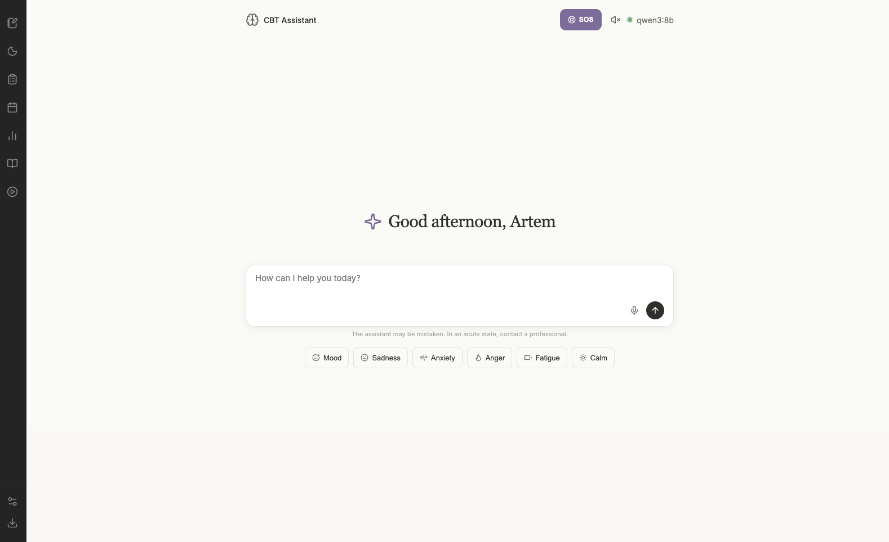

# MindBridge — Local-First CBT Journal and AI Mental Wellness Assistant

MindBridge is a local-first mental wellness application that combines CBT-inspired self-reflection, journaling, mood and sleep tracking, and conversational AI powered by Ollama.

This repository contains my modifications to an existing CBT assistant project. The work focuses on improving the local application experience, model configuration, data handling, documentation, and quality-assurance workflow.

## Project Overview

MindBridge explores how conversational AI and structured self-reflection tools can be brought together in a locally run wellness application.

Alongside application development, this project includes a data-quality and product analytics audit examining how user records are stored, associated with sessions, and retained across application use.

## Maintainer

**Nishanth S Reddy**

- GitHub: [ErrorByNight2004](https://github.com/ErrorByNight2004)
- Project Repository: [mindbridge-local-ai](https://github.com/ErrorByNight2004/mindbridge-local-ai)

## Key Features

- **AI Chat Assistant:** Conversational support using a locally running Ollama model.
- **Thought Diary:** Record situations, automatic thoughts, emotions, and alternative perspectives.
- **Mood Tracking:** Record mood scores and review available progress information.
- **Sleep Journal:** Record sleep and wake times, sleep quality, and interruptions.
- **CBT-Inspired Exercises:** Use structured self-reflection techniques to examine thought patterns.
- **Knowledge Retrieval:** Retrieve relevant information from the local knowledge base when retrieval is enabled.
- **Assessment History:** Store supported assessment results and associate records with sessions.

## Technology Stack

| Area | Technology |
|---|---|
| AI inference | Ollama |
| Language model | Qwen 3.5 4B |
| Backend | Python, FastAPI |
| Frontend | HTML, CSS, JavaScript |
| Data storage | SQLite |
| Knowledge retrieval | Local knowledge base and retrieval components |

## Application Preview



## Data Quality and Validation

A practical data-quality audit was conducted using the application's SQLite database and functional UI tests.

The audit covered message records, session references, mood logs, thought records, sleep logs, activities, and assessment results.

### Audit Snapshot

| Validation Area | Observed Result | Status |
|---|---:|---|
| Messages | 96 records across 6 sessions | Pass |
| Messages with missing session IDs | 0 | Pass |
| Orphaned session references in checked tables | 0 | Pass |
| Mood records | 1 record | Partial |
| Thought diary records | 1 record | Partial |
| Sleep journal records | 1 record | Partial |
| Assessment records | 2 records | Partial |
| Activity records | 0 records | Not tested |

**Important:** These results describe the database snapshot used for the audit. Partial results indicate that record creation or basic persistence was observed, but complete synchronization and session-isolation behavior were not fully verified.

### Key Observations

- Message records had valid session references in the audited snapshot.
- Thought diary and sleep journal entries remained visible after refreshing the application.
- The mood score was stored as 10 in the database, while the calendar displayed it as `10/5`. This is a potential presentation or mapping issue requiring further investigation.
- Cross-session access isolation and complete-list synchronization require additional testing.
- No activity records were present in the audited database snapshot.

## Portfolio and Project Documentation

The project includes supporting materials documenting the data-quality audit and product analytics work.

| Deliverable | Description |
|---|---|
| [Product Analytics Case Study](docs/portfolio/MindBridge_Data_Quality_Product_Analytics_Case_Study.docx) | Project analysis, audit findings, and improvement recommendations |
| [Data Quality Audit Workbook](docs/portfolio/MindBridge_Data_Audit.xlsx) | Data dictionary, initial audit, and validation checklist |
| [Audit Infographic](docs/portfolio/MindBridge%20Data%20Quality%20Audit%20Infographic.png) | Visual summary of the data-quality audit |

Additional technical documentation:

- [Architecture](docs/ARCHITECTURE.md)
- [Development Guide](docs/DEVELOPMENT.md)
- [Privacy and Safety](docs/PRIVACY_AND_SAFETY.md)

## Installation and Setup

### Requirements

- Python
- Ollama
- Git
- Dependencies listed in `requirements.txt`
- Sufficient RAM and disk space for the selected language and embedding models

### 1. Clone the Repository

```bash
git clone https://github.com/ErrorByNight2004/mindbridge-local-ai.git
cd mindbridge-local-ai
```

### 2. Create a Virtual Environment

On Windows PowerShell:

```powershell
python -m venv .venv
.\.venv\Scripts\Activate.ps1
pip install -r requirements.txt
```

### 3. Start Ollama and Pull the Configured Model

```bash
ollama pull qwen3.5:4b
```

Ensure Ollama is running before starting the application.

### 4. Start the Backend

From the project root:

```bash
python -m uvicorn backend.server:app --host 127.0.0.1 --port 8000
```

### 5. Open the Application

Visit:

[http://127.0.0.1:8000](http://127.0.0.1:8000)

## Configuration

Model settings are maintained in:

```text
config/model_config.yaml
```

Review the configured model, generation parameters, and local data directories before running the application.

## Limitations and Future Improvements

The following areas have been identified for further development and validation:

- Complete session-isolation testing across all user-record types.
- Consistent synchronization and retrieval of journal and activity records.
- Investigation of the mood score display discrepancy.
- Improved traceability of knowledge-base citations.
- Additional validation of data persistence and error handling.
- Clearer privacy controls and documentation for optional external integrations.

## Privacy and Safety

MindBridge is intended for self-reflection and general wellness support. It is not a therapist, medical device, emergency service, or substitute for professional mental health care.

Local model inference does not automatically mean every feature operates offline. Optional voice, media, or other integrations may use external services. Review the application's configuration and privacy documentation before entering sensitive information.

Do not expose the local server to untrusted networks without addressing authentication, CORS, and other security requirements.

For more information, see [Privacy and Safety](docs/PRIVACY_AND_SAFETY.md).

## Development and Contributions

See [CONTRIBUTING.md](CONTRIBUTING.md) for contribution guidance.

Please report security vulnerabilities through the process described in [SECURITY.md](SECURITY.md), rather than through public issues.

## Original Project and License

This repository is based on an existing project originally attributed to **KazKozDev**.

The original MIT License and required copyright notices must be preserved. My work represents modifications to the original project; original authorship and third-party attributions remain acknowledged.

See [LICENSE](LICENSE) for the applicable license terms.